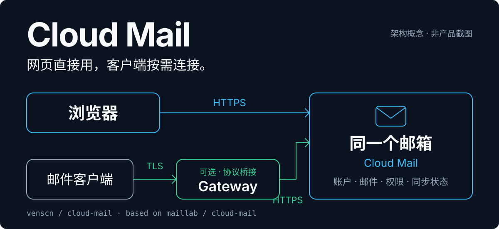

# Cloud Mail

**自己的域名邮箱：网页直接用，需要时再连接邮件客户端。**

这是**基于 [maillab/cloud-mail](https://github.com/maillab/cloud-mail) 的 [venscn 维护扩展版](https://github.com/venscn/cloud-mail)**，属于独立维护的二次开发分支，并非上游官方版本。保留原作的 Web Mail 基础，扩展管理员发信渠道、发件人兼容处理，以及可选的 IMAP / SMTP 客户端接入。

<p align="center">
  
</p>

**只用网页，不需要 Gateway。** 若要使用 iOS 邮件或标准 IMAP / SMTP 客户端，再配套部署 [Cloud Mail Gateway](https://github.com/venscn/cloud-mail-gateway)。Cloud Mail 始终负责账户权限、邮件、同步状态、现有附件存储和发信渠道；Gateway 只做协议桥接。

[功能与架构](#功能与架构) · [开始使用](#开始使用) · [文档与验证](#文档与验证) · [使用边界](#使用边界) · [来源与许可证](#来源与许可证)

上游语言说明：[English](./README-en.md) · [日本語](./README-ja.md)（保留上游介绍，不是本分支完整指南）

## 功能与架构

### 继承原作：可独立使用的 Web Mail

以下基础能力来自原作及其贡献者，并非本分支从零实现：

- **域名邮箱与网页收发**：多邮箱、邮件搜索、附件、抄送 / 密送，以及适配桌面和手机浏览器的界面。
- **用户与权限管理**：管理账户、角色、功能和资源限制。
- **Cloudflare 基础设施**：Workers + Hono 后端，D1 数据、KV 缓存及既有附件存储；Vue 3 + Element Plus 前端。
- **原有发送与通知集成**：Cloudflare Email、Resend、Telegram / 邮箱转发，以及可配置的验证码识别、Turnstile、统计和界面设置。

### 本分支增强：渠道、身份与客户端接入

- **管理员发信渠道**：在原有渠道基础上增加 SendPulse / QQ SMTP 配置、每日配额和可保存的渠道顺序。默认顺序为 Resend → SendPulse → QQ → Cloudflare；按配置和配额选择，不是所有异常都自动重发。
- **发件人兼容处理**：SendPulse 校验信封发件人与可见发件人的同域关系；QQ 代发使用登录地址作为 From，以实际邮箱作为 Reply-To，并在正文开头提示实际发件邮箱。
- **客户端 API 与同步元数据**：增加独立的 `/api/gateway/v1`，维护邮箱 UID、标记、文件夹和变更游标，并复用现有邮件与附件数据。
- **按邮箱授权的应用密码**：在个人设置为设备创建独立密码，选择读取 / 同步 / 发信权限，支持撤销；不使用网页登录密码。
- **清楚的客户端说明**：管理员分别配置 IMAP / SMTP 展示主机名；用户查看自己的连接参数、应用密码及邮件应用发信结果。隐藏客户端区块不会停掉网关或撤销密码。
- **独立连接测试**：仅系统管理员可测试已保存的 IMAP 993 / SMTP 465 主机，检查 DNS、TLS 连接及未登录协议响应；不读取密码、不登录、不发信。
- **个人页面细节**：隐藏被关闭的公告区块和不适用的邮箱配额展示，避免把管理员信息混入普通用户的客户端说明。

上述差异可在[渠道与身份回归说明](./mail-worker/test/README.md)、[迁移与存储契约](./mail-worker/migrations/README.md)、[真实跨语言集成说明](./mail-worker/test/gateway-integration/README.md)及[连接测试边界](./mail-worker/test/connectivity/README.md)中核对。测试说明是验证方法与覆盖范围，不代表已通过真实设备或公网部署验收。

### 两个仓库，仍然是同一个邮箱

```text
浏览器 ── HTTPS ────────────────────── Cloud Mail
                                              │
邮件客户端 ── TLS ── 可选 Gateway ── HTTPS ─────┘
```

- **本仓库**：[venscn/cloud-mail](https://github.com/venscn/cloud-mail) — 网页、管理界面、Worker API 和邮件数据权威。
- **配套仓库**：[venscn/cloud-mail-gateway](https://github.com/venscn/cloud-mail-gateway) — 单独运行的 Go IMAP / SMTP 服务，需要本维护扩展版的 Gateway API；不能直接假设原版上游兼容。
- **存储不搬家**：网关接入不会创建第二套邮箱，也不要求为此新建 R2 桶或切换附件后端。按已有配置使用 S3 / KV / R2 附件存储，客户端 MIME 由现有数据确定性重建。

## 开始使用

### 1. 先选择使用方式

**只用网页邮箱**：先阅读[上游部署文档](https://docs.skymail.ink)，了解域名、Cloudflare Email Routing、Workers、D1、KV、附件存储及发送服务的基础配置。随后对照本仓库版本和新增配置进行部署评审。**上游文档不涵盖本分支的发送渠道和 Gateway 增强，不能当作完整的本分支升级指南。**

**还要连接邮件客户端**：先让 Web Mail 可用，再按[本分支迁移说明](./mail-worker/migrations/README.md)和 [Gateway 部署文档](https://github.com/venscn/cloud-mail-gateway/blob/main/docs/deployment.md)准备匹配的 Worker、网关、DNS、可信 TLS 证书和端口。

现有实例升级前应私下备份并在隔离环境演练。Gateway 元数据迁移依赖既有 v3.7 旧表结构，不能在空库直接套用，也不要盲目执行整个迁移目录。普通 Worker 启动不会自动完成这些迁移。

### 2. 获取代码，先做无部署检查

以下操作只获取源码并离线核对 SQL 镜像，不初始化数据库、不访问邮件、不部署 Worker：

```sh
git clone https://github.com/venscn/cloud-mail.git
cd cloud-mail/mail-worker
node scripts/gateway-migration.mjs --check
```

这个检查仅证明已跟踪的 Gateway SQL 镜像与源码一致，不证明实例已迁移。构建和运行前还需按锁文件安装对应前后端依赖，并在操作者掌控的私有配置中填入实际资源。

> **不要把 `npm test` / `pnpm test` 当成离线测试。** Worker 的默认 `test` 脚本会部署测试 Worker；默认启动、部署和初始化也不应在未核实配置时运行。不要把真实密钥写入命令、README、截图或公开提交。

### 3. 网关就绪后，再添加设备

1. 管理员分别保存收件和发件主机名，例如 `imap.example.com` 与 `smtp.example.com`，完成实际 DNS / TLS / 端口验证后，再开启个人设置中的客户端区块。
2. 用户在「个人设置 → 邮件客户端与应用密码」选择本人邮箱，为每台设备创建独立的应用密码。密码只显示一次；遗失时撤销并重建。
3. 在客户端选择 IMAP：收件使用 **993 + SSL/TLS**；发件使用 **465 + SSL/TLS**。两处用户名都填完整邮箱地址，例如 `alice@example.com`，两处密码都填应用密码。
4. 仅当 Gateway 明确启用时，SMTP 才可选 **587 + STARTTLS**。遇到证书警告不要忽略或关闭 TLS；先修正配置，再验证收件、同步及发件。

此接入方式无需为 Gateway 改动 MX，也不使用端口 25。示例域名与邮箱均为合成数据，不能直接用于真实收发。

## 文档与验证

- [上游部署文档](https://docs.skymail.ink)：原作部署基础，不覆盖本分支新增功能。
- [Gateway 迁移、现有存储与回滚注意事项](./mail-worker/migrations/README.md)：Worker 侧初始化、受控升级和离线验证入口。
- [发件人身份及渠道回归](./mail-worker/test/README.md)：合成数据测试，说明哪些发送边界被替换。
- [跨语言集成验证](./mail-worker/test/gateway-integration/README.md)：真实 Go TLS 协议与 Worker API 的本地合成联测；不是生产投递验收。
- [连接测试安全边界](./mail-worker/test/connectivity/README.md)：权限、冷却、超时和平台依赖。
- [Gateway README](https://github.com/venscn/cloud-mail-gateway)：协议支持、安装和运行入口。

源码入口保持简洁：[前端](./mail-vue) · [Worker](./mail-worker) · [数据库迁移](./mail-worker/migrations)。完整目录以仓库文件为准。

## 使用边界

- **不是完整通用邮件服务器**：原作 Web Mail 能力和本分支协议桥接都受 Cloudflare、发送服务、账户权限与配额约束。管理员填写主机名不会自动部署 Gateway、配置 DNS 或申请证书。
- **不是原始 MIME 归档**：客户端读取的 MIME 从已有邮件及附件数据重建，不承诺恢复最初接收的原始字节。缺失附件、超限或内容变化会产生明确错误，不能用重写哈希掩盖。
- **客户端操作有限**：不支持新 APPEND（含客户端上传草稿）或 COPY；MOVE 针对已有邮件的元数据映射。对既有 Sent 的严格等值 APPEND 确认不是通用上传能力。选择客户端前应阅读 [Gateway 支持范围](https://github.com/venscn/cloud-mail-gateway)。
- **提交不等于送达**：发信结果未确认或部分成功时，先刷新、逐个核对收件人并由管理员排查，不要盲目重复发送。渠道回退也不代表可以安全重试所有失败。
- **连接成功不等于邮箱可用**：管理员连接测试不进行认证；生产 TLS 和目标地址防护依赖 Cloudflare，离线测试无法证明真实公网、iOS 兼容或最终投递。
- **开源代码与实例数据分开**：源码按许可证分发；你的 VPS、Cloudflare 配置、应用密码、邮件和备份应私下管理。公开代码不意味着公开你的运行实例或凭据。

## 来源与许可证

- 原作仓库：**[maillab/cloud-mail](https://github.com/maillab/cloud-mail)**；原作者：[aslost](https://github.com/aslost)。感谢原作者与所有上游贡献者。
- 本仓库：**[venscn/cloud-mail](https://github.com/venscn/cloud-mail)**，由 venscn 维护的二次创作 / 扩展分支。Git 历史中的原作者及贡献记录保留，不将继承功能归为本分支原创。
- 本项目遵循 [MIT License](./LICENSE)。原许可证全文保持不变，包括 **`Copyright (c) 2025 aslost`**；再分发时须保留原版权与许可声明，软件按原许可证「AS IS」提供。
- 英文及日文 README 保留上游介绍；其中演示、截图、发行链接、推荐奖章及社区链接均属于上游，不构成本维护扩展版的演示、获奖或兼容性背书。主 README 使用明确标注的架构概念图，不伪造产品截图。
